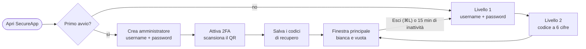

# SecureApp

**Scheletro di applicazione desktop in Python per macOS, distribuita come `.dmg`, con autenticazione a due livelli.**

Doppio clic sull'app → si apre una finestra che chiede subito l'accesso (password + codice OTP) → dopo il login la finestra è bianca e vuota, pronta per il contenuto.

`Python 3.13` · `PySide6 6.12 (Qt)` · `PyInstaller` · `Argon2id` · `TOTP RFC 6238` · `AES-256-GCM` · `37 test automatici`



---

## 1. Il quadro in 30 secondi

| Pezzo | Cos'è |
|---|---|
| `main.py` + `secureapp/` | il programma Python (finestra fatta con **PySide6**, cioè Qt) |
| `SecureApp.app` | il programma "vero" per macOS: **PyInstaller** ci mette dentro Python, Qt e il tuo codice, quindi chi lo usa non deve installare nulla |
| `SecureApp-0.1.0.dmg` | l'immagine disco con cui si distribuiscono le app su Mac: un contenitore con dentro l'`.app` e la scorciatoia ad Applicazioni (creato con **hdiutil**, già incluso in macOS) |

Il `.dmg` non avvia il programma da solo: lo apri, trascini l'app in Applicazioni e la avvii. È il flusso standard di installazione su Mac.

## 2. Prerequisiti (una volta sola)

| Cosa | Perché | Come |
|---|---|---|
| macOS 14 o successivo | le librerie Qt di PySide6 6.12 sono compilate per macOS 14+ | — |
| Xcode Command Line Tools | PyInstaller usa `install_name_tool` e `lipo` | `xcode-select --install` (se usi pyenv o Homebrew li hai già) |
| Python 3.13 **con libreria condivisa** | PyInstaller deve copiare la libreria di Python dentro l'app | vedi sotto |
| App di autenticazione sul telefono | genera i codici a 6 cifre | **Password** di iPhone (iOS 18+), Google Authenticator, Microsoft Authenticator… |

**Opzione A, consigliata: installer di [python.org](https://www.python.org/downloads/macos/)** (Python 3.13). È già compilato nel modo giusto.

**Opzione B: pyenv.** Di default pyenv compila Python *senza* libreria condivisa e PyInstaller si ferma con `Python library not found`. Reinstalla la versione così:

```bash
env PYTHON_CONFIGURE_OPTS="--enable-framework" pyenv install 3.13   # aggiungi --force se è già installata
pyenv versions                                                       # leggi il numero esatto, es. 3.13.x
```

Lo script di build controlla comunque questo punto e, se manca, ti dice cosa fare.

## 3. Provare l'app (senza creare il .dmg)

```bash
cd ~/Downloads/SecureApp     # la cartella estratta dallo zip
/Library/Frameworks/Python.framework/Versions/3.13/bin/python3 -m venv .venv   # Python di python.org
source .venv/bin/activate
pip install -r requirements-dev.txt
python main.py
```

*Con pyenv, al posto della seconda riga: `pyenv local 3.13.x` e poi `python -m venv .venv`.*

**Primo avvio:** crei l'amministratore → con l'app di autenticazione del telefono inquadri il QR (con l'app Password di iPhone: apri o crea la voce dell'account, tocca Modifica e imposta il codice di verifica) → digiti il codice a 6 cifre → salvi gli 8 codici di recupero → finestra bianca.
**Avvii successivi:** username e password → codice a 6 cifre → finestra bianca.

## 4. Creare l'app e il .dmg

```bash
bash build_mac.sh
# con un Python specifico:
PYTHON=/Library/Frameworks/Python.framework/Versions/3.13/bin/python3 bash build_mac.sh
```

Lo script fa sei passi e si ferma con un messaggio chiaro al primo problema:

1. controlla Python (versione e libreria condivisa) e gli Xcode Command Line Tools;
2. crea `.venv` e installa le dipendenze con le versioni fissate;
3. esegue i 37 test;
4. crea `dist/SecureApp.app` con PyInstaller (`app.spec`);
5. verifica la firma ad-hoc e lancia l'app impacchettata con `--selftest` (controlla che tutte le librerie funzionino dentro l'app);
6. crea `dist/SecureApp-0.1.0.dmg` con `hdiutil` e ne verifica il checksum.

## 5. Usare il .dmg

1. Doppio clic su `SecureApp-0.1.0.dmg`: si apre una finestra del Finder con SecureApp e la scorciatoia **Applicazioni**.
2. Trascina SecureApp su Applicazioni (oppure doppio clic per provarla direttamente dal disco).
3. Espelli il disco "SecureApp".
4. Apri SecureApp da Applicazioni o Launchpad: la finestra si apre sul login.

### Se la dai ad altre persone

- **Gatekeeper.** Sul tuo Mac l'app si apre senza avvisi perché l'hai creata tu. Su un altro Mac, scaricata da internet, viene bloccata perché non è firmata con un certificato Apple Developer ID né notarizzata. Chi la riceve fa: Impostazioni di Sistema → Privacy e sicurezza → sezione Sicurezza → **Apri comunque** (il pulsante resta per circa un'ora dopo il tentativo di apertura) → password del Mac. Per eliminare l'avviso serve l'Apple Developer Program: firma con `codesign_identity` in `app.spec` e notarizzazione con `xcrun notarytool`.
- **Processore.** L'app viene compilata per il processore del Mac su cui la crei (Apple Silicon su un Mac M). Per un Mac Intel va creata su un Mac Intel.

## 6. Sicurezza: requisito → implementazione

| Requisito della specifica | Implementazione | Dove |
|---|---|---|
| **Primo livello**: username e password | Stesso messaggio d'errore per utente inesistente e password sbagliata, e stesso tempo di risposta (verifica fittizia), così non si scopre quali utenti esistono | `auth.py` → `login_password` |
| **Secondo livello**: OTP / 2FA | TOTP (RFC 6238): codice a 6 cifre ogni 30 s da un'app di autenticazione, attivato con QR code; tolleranza ±30 s; ogni codice vale una sola volta (anti-replay); 8 codici di recupero monouso se perdi il telefono | `verify_otp`, `verify_recovery_code` |
| **Secure password storage** | Argon2id (64 MiB, t=3, p=4, sopra il minimo OWASP di 19 MiB, t=2, p=1) con salt casuale: la password non viene mai salvata. Regole NIST SP 800-63B-4: almeno 12 caratteri, nessun obbligo di maiuscole o simboli, rifiuto delle password comuni ("Password2024!", "P@ssw0rd"…) | `security.py`, `policy.py` |
| | Il segreto TOTP è cifrato con AES-256-GCM con una chiave derivata dalla password (Argon2id, salt separato): chi copia il database non può leggerlo | `confirm_enrollment` |
| Protezione da tentativi ripetuti | 5 errori consecutivi (password o codice) → account bloccato 15 minuti; il blocco è salvato su disco, quindi riavviare l'app non lo aggira | `_register_failure` |
| **Session management** | Token casuale da 256 bit; uscita automatica dopo 15 minuti di inattività e comunque dopo 8 ore (dentro i limiti OWASP ASVS livello 3: 15 min / 12 h); Esci con ⌘L; nessuna sessione salvata su disco, quindi a ogni avvio si rifà il login | `check_session`, `touch`, `logout` |
| **Access controls** | Ruoli `admin` / `user` / `viewer` → permessi; decoratore `@requires("permesso")`; il ruolo è riletto dal database a ogni chiamata; tutto ciò che non è esplicitamente permesso è negato | `ROLE_PERMISSIONS`, `requires` |
| Tracciabilità | Tabella `audit_log`: accessi, errori, blocchi, accessi negati (mai password, codici o segreti) | `storage.py` |
| Dati locali | `~/Library/Application Support/SecureApp/`, cartella leggibile solo da te (700), database 600; query SQL parametrizzate (niente SQL injection) | `config.py`, `storage.py` |

Tutti i parametri (timeout, tentativi, lunghezza minima, durata del blocco) sono in `secureapp/config.py`. Per dati finanziari valuta un'inattività di 5 minuti: l'OWASP Session Management Cheat Sheet cita 2–5 minuti per le applicazioni ad alto valore.

## 7. Dove aggiungere il tuo contenuto

- **La finestra bianca** è `HomePage` in `secureapp/ui.py`: aggiungi lì layout e widget. Ha già `self.session` (l'utente collegato) e `self.auth` (il servizio).
- **Le operazioni da proteggere** vanno in un servizio, dietro `@requires(...)`:

```python
# secureapp/auth.py, dentro AuthService
@requires("data.write")
def save_note(self, session: Session, text: str) -> None:
    ...  # ci arrivi solo con una sessione valida e un ruolo che ha "data.write"
```

```python
# secureapp/ui.py, dentro HomePage
self.auth.save_note(self.session, "testo")
```

- **Nome dell'app**: `APP_NAME` e `BUNDLE_ID` in `secureapp/config.py` (li leggono anche `app.spec` e `build_mac.sh`). Cambiando il nome cambia anche la cartella dei dati.
- **Icona**: crea un file `.icns` e indicalo in `app.spec` (`icon="assets/icon.icns"`).
- **Lingua**: i testi dell'interfaccia sono in inglese, come la specifica; si cambiano in `ui.py`.

## 8. Test

```bash
pytest                                        # 37 test
SCREENSHOT_DIR=shots pytest tests/test_ui.py  # salva anche le schermate in shots/
```

I test coprono: flusso completo della finestra; password mai salvate in chiaro; vettori ufficiali RFC 6238 (stessi codici di qualsiasi app di autenticazione); blocco dopo 5 errori; anti-replay; tolleranza dell'orologio; scadenza dei passaggi e della sessione; codici di recupero monouso; ruoli e permessi; cambio password con 2FA che continua a funzionare; segreto cifrato legato al proprio utente.

## 9. Problemi comuni

| Sintomo | Soluzione |
|---|---|
| `Python library not found` durante la build | Python senza libreria condivisa: vedi il punto 2 |
| `xcrun: error: invalid active developer path` | `xcode-select --install` |
| Doppio clic sull'app e non succede nulla | Avviala da Terminale per leggere l'errore: `dist/SecureApp.app/Contents/MacOS/SecureApp`. Log: `~/Library/Application Support/SecureApp/app.log` |
| Il codice a 6 cifre viene sempre rifiutato | Attiva data e ora automatiche su iPhone e sul Mac |
| "Too many failed attempts" | Aspetta 15 minuti |
| Ricominciare da zero (cancella utenti e 2FA) | `rm -rf ~/Library/Application\ Support/SecureApp` |

## 10. Struttura

```
SecureApp/
├── main.py               avvio (anche il file che PyInstaller impacchetta)
├── secureapp/
│   ├── config.py         nome app, percorsi, parametri di sicurezza
│   ├── policy.py         regole per username e password (NIST)
│   ├── security.py       Argon2id, AES-256-GCM, TOTP, codici di recupero
│   ├── storage.py        database SQLite
│   ├── auth.py           autenticazione, sessioni, ruoli e permessi
│   ├── ui.py             finestra e pagine (PySide6)
│   └── selftest.py       controllo dell'app impacchettata
├── tests/                test automatici (pytest)
├── app.spec              ricetta PyInstaller per l'.app
├── build_mac.sh          .app + .dmg in un comando
└── requirements*.txt     dipendenze con versioni fissate
```

## 11. Tutorial e fonti

**Parte 1: dal codice Python all'app `.app` e al `.dmg`**
- [Packaging PySide6 applications into a macOS app with PyInstaller](https://www.pythonguis.com/tutorials/packaging-pyside6-applications-pyinstaller-macos-dmg/) (pythonguis.com): il tutorial di riferimento, passo passo fino al `.dmg`. Usa `create-dmg` (`brew install create-dmg`) per una finestra del `.dmg` più curata; qui si usa `hdiutil`, già incluso in macOS.
- [Qt for Python & PyInstaller](https://doc.qt.io/qtforpython-6.11/deployment/deployment-pyinstaller.html) (documentazione ufficiale Qt)
- [Using PyInstaller](https://pyinstaller.org/en/stable/usage.html) (documentazione ufficiale)

**Parte 2: autenticazione a due livelli**
- [How to Implement 2FA in Python](https://thepythoncode.com/article/implement-2fa-in-python) (The Python Code): TOTP con pyotp e QR code
- [PyOTP](https://pyauth.github.io/pyotp/) (documentazione della libreria usata)
- [OWASP Password Storage Cheat Sheet](https://cheatsheetseries.owasp.org/cheatsheets/Password_Storage_Cheat_Sheet.html)
- [OWASP Session Management Cheat Sheet](https://cheatsheetseries.owasp.org/cheatsheets/Session_Management_Cheat_Sheet.html)
- [NIST SP 800-63B-4: Authenticators](https://pages.nist.gov/800-63-4/sp800-63b/authenticators)

**macOS**
- [Aprire un'app di uno sviluppatore non identificato](https://support.apple.com/guide/mac-help/open-a-mac-app-from-an-unidentified-developer-mh40616/mac) (Apple)
